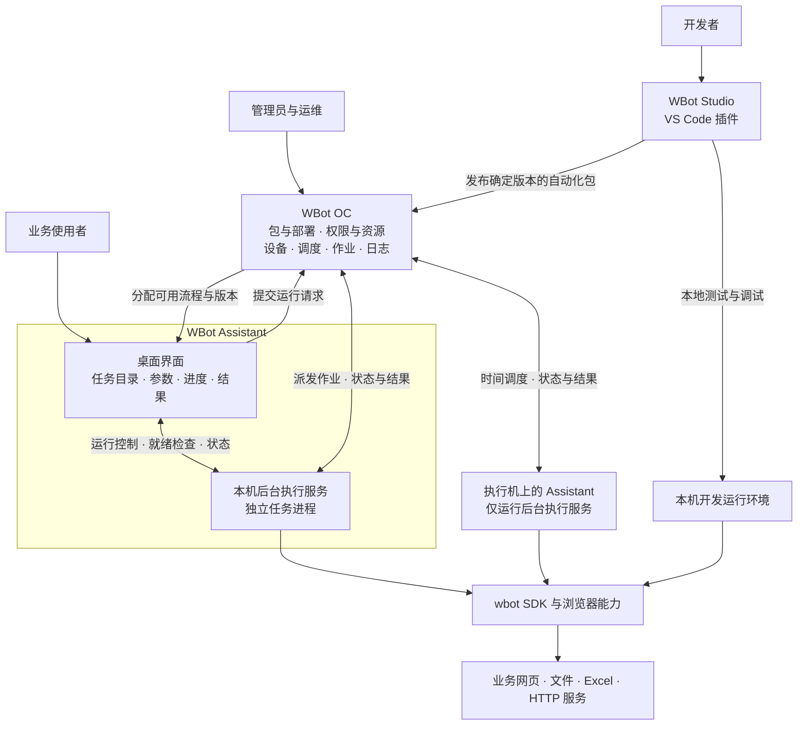

# WBot 自动化平台产品需求与需求架构草案

版本：0.7 · 日期：2026-11-09 · 状态：产品评审草案，含三端协作、远程设备接入与共享元素版本管理实现对照

WBot 的目标是一套覆盖开发、发布、使用和集中运营的 Python 自动化平台。产品由 **WBot Studio（VS Code 插件）、WBot OC（管理与调度平台）、WBot Assistant（桌面客户端，包含后台执行服务）** 三端组成。执行服务属于 Assistant 内部能力，不另设独立的执行端产品。名称暂沿用现有项目，正式品牌另行确认。

已确认：参考 UiPath 的产品分工；Studio 由 VS Code 插件承担；需要类似 Orchestrator 和 Assistant 的产品；首版采用企业私有部署，支持一个组织。单组织包含多用户、多业务空间和多台执行设备。OC 管理界面采用 React；Assistant 定位为本地安装、紧凑窗口和托盘常驻的桌面软件，界面技术采用 PySide6 + Qt Widgets。

本文的首版功能、分期和验收标准是产品建议。现状判断依据仓库源码、测试与文档；开发预览的具体边界见第 10 节、[OC 使用指南](oc.md) 和 [Assistant 使用指南](assistant.md)。已有预览能力不表示完整 M1、OC 首版或企业私有部署已通过验收。此前插件侧的项目、元素、环境与诊断需求纳入 Studio；平台整体范围以本文为准。

## 1 产品定位与参考原则

### 1.1 产品目标

开发者使用 Python 构建自动化，业务人员通过 Assistant 使用已发布任务，管理员和运维人员通过 OC 管理版本、权限、设备、调度和执行结果。执行设备通过 Assistant 内部执行服务完成任务，不要求保持 VS Code 或 Assistant 窗口打开。

平台首先支持已有基础较好的网页自动化、文件与数据处理。开发工具面向 RPA/Python 开发者；完整平台还需要服务业务使用者和自动化运维人员。

### 1.2 UiPath 的职责划分与本产品映射

| UiPath 参考 | 官方职责摘要 | WBot 对应产品 | 本产品重点 |
| --- | --- | --- | --- |
| Studio | 开发自动化并发布 | WBot Studio，VS Code 插件 | Python 项目、元素、调试、参数声明、构建发布 |
| Orchestrator | 集中部署、配置、调度与监控自动化资源 | WBot OC，Web 管理平台 | 包与版本、流程部署、设备、作业、触发器、资源、权限 |
| Assistant | 桌面上的自动化访问与使用入口，是 Robot 的客户端 | WBot Assistant，桌面应用 | 我的自动化、参数填写、本机运行、进度与结果 |
| Robot Service 与 Executor | 维护连接、接受任务并实际执行 | Assistant 内部执行服务与任务进程 | 设备注册、执行环境、任务生命周期、日志结果回传；不独立为第四个产品 |

UiPath 将集中管理职责放在 Orchestrator，将用户操作入口放在 Assistant，并由 Robot 负责执行。上述职责划分依据其官方说明：[Orchestrator 简介](https://docs.uipath.com/orchestrator/automation-cloud/latest/user-guide/introduction)、[Assistant 简介](https://docs.uipath.com/assistant/standalone/latest/user-guide/about-uipath-assistant)、[Robot 组件](https://docs.uipath.com/robot/standalone/latest/admin-guide/robot-components)。

以下功能和分期为 WBot 的产品设计，不代表 UiPath 各版本的完整功能清单，也不要求兼容其项目文件、包格式、协议或商业许可体系。

### 1.3 核心角色

| 角色 | 主要入口 | 要完成的工作 |
| --- | --- | --- |
| 自动化开发者 | Studio | 开发、调试、定义输入输出、发布版本、定位失败原因 |
| 业务使用者 | Assistant | 查找获授权自动化、填参数、启动任务、查看结果 |
| 自动化运维人员 | OC | 部署流程、配置执行设备和计划、监控作业、处理故障 |
| 平台管理员 | OC | 管理账号、业务空间、角色、设备接入、凭据和备份 |
| 任务执行身份 | 执行服务 | 按授权访问业务资源并执行任务；与发起用户身份分别记录 |

首版可由一人承担多个角色，但权限含义保持独立。业务人员无需安装 VS Code 或编辑 Python 文件。

## 2 整体产品架构

三个产品分别负责开发、管理和使用执行。Assistant 内部将桌面界面与后台执行服务分为独立进程；专用执行机可只运行它的执行服务。无界面部署是 Assistant 的运行方式，不增加一个独立产品。

OC 是组织内的管理中心和正式作业记录来源。Assistant 展示使用者有权运行的流程，Studio 发布包但不直接替换生产部署。浏览器扩展与本机桥属于执行环境能力，不能由开发编辑器独占管理。

### 2.1 各端职责与边界

| 产品 | 负责什么 | 与其他端的关系 |
| --- | --- | --- |
| Studio | 编码、元素抓取与维护、环境检查、调试、参数与依赖声明、构建发布 | 发布到 OC；本地开发执行可独立于 OC，正式作业使用已发布包 |
| OC | 保存发布版本，配置可执行流程、授权、运行目标与计划，汇总状态结果 | 向执行服务分配作业，向 Assistant 提供任务目录，向 Studio 提供发布结果 |
| Assistant | 登录组织、浏览流程、填写参数、启动与停止、查看运行和产物；内部执行服务管理设备身份、环境、任务进程和结果回传 | 发起正式运行需 OC 授权；后台执行服务不依赖 Studio 或 Assistant 界面进程持续打开 |

关闭 Assistant 窗口、退出 Assistant 界面进程和停止 Assistant 后台执行服务是不同动作。前两者不应终止已被执行服务接受的作业；注销操作系统会话、停止执行服务或机器关机会影响任务，必须报告相应中断状态。

## 3 产品核心对象与统一术语

UiPath 将部署并配置后的包定义为 Process，将一次流程执行定义为 Job；本产品采用相同的业务区分，具体数据与实现自行设计。[UiPath Processes](https://docs.uipath.com/orchestrator/automation-cloud/latest/user-guide/about-processes)、[UiPath Jobs](https://docs.uipath.com/orchestrator/automation-cloud/latest/user-guide/about-jobs)

| 对象 | 产品含义 | 示例与规则 |
| --- | --- | --- |
| 组织 | 一套私有部署服务的企业 | 首版一个组织，无 SaaS 租户运营功能 |
| 业务空间 | 组织内隔离流程、资源和权限的工作范围 | 财务、运营；首版可用独立空间区分测试与生产 |
| 项目 Project | 开发者编辑的源码和资产 | Python、元素、依赖、参数说明、入口脚本 |
| 发布包 Package | 项目构建得到的可分发制品 | 订单导出 1.2.0；同一版本内容不可覆盖 |
| 自动化流程 Process | 在业务空间中配置好的可运行应用 | 包版本 + 入口 + 参数默认值 + 资源引用 + 运行模式 + 授权 |
| 作业 Job | 对某个流程的一次执行请求和结果 | 谁在何时用哪些参数、哪个版本、在哪台机器运行 |
| 执行设备与执行服务 | 可以承接作业的机器及执行能力 | 在线状态、运行模式、环境能力、可承接空间、容量 |
| 触发器 Trigger | 产生作业的规则 | 每工作日 09:00；首版先提供时间规则 |
| 配置与凭据 Asset | 运行时需要的组织资源 | 系统地址、配置值、密码或令牌引用 |
| 业务队列 Queue | 待处理业务数据的集合 | 每张发票、每个订单为一项；与作业等待派发列表不同 |
| 结果与文件 Artifact | 作业输出的结构化结果或文件 | 汇总数、CSV、报表、错误附件 |
| 元素资产 Selector | 项目内的网页定位资源 | 元素名、分组、定位规则和稳定页面信息，随包发布 |

这里的 Process 表示已部署的 Python 自动化应用，不要求提供可视化流程编辑器。

主关系：**项目 → 发布包版本 → 流程部署 → 作业 → 日志和结果**。用户点击“运行”创建的是作业；上传新包不会自动替换线上流程。Job 创建时固定包版本、非敏感配置及输入快照；排队或运行中的作业均不跟随部署更新。凭据只保存引用，执行时仍需检查当前授权。

业务队列用于逐条处理和追踪业务数据，概念参考 [UiPath Queues and Transactions](https://docs.uipath.com/orchestrator/automation-cloud/latest/user-guide/about-queues-and-transactions)。首版先完成作业调度；业务队列列入下一阶段。

## 4 WBot Studio 产品需求

Studio 由 VS Code 插件承载，沿用 VS Code 的文件管理、Git、Python 编辑、终端和 debugpy。现有抓取与元素库能力继续建设。

| 编号 | 需求 | 首版验收条件 |
| --- | --- | --- |
| ST01 | 自动化项目初始化与环境检查 | 明确项目、入口、Python/wbot 和可选依赖；新用户按引导运行示例；安装、运行、调试使用同一环境 |
| ST02 | 项目级元素资产 | 两个项目的同名元素互不混用；抓取候选可比较和校验；页面与框架可见；改名提示影响；发布时不携带临时文档身份 |
| ST03 | 输入输出与运行模式声明 | 声明参数名称、类型、必填、默认值、说明及输出；声明有人/无人值守、是否需要交互会话；Assistant/OC 可据此生成表单和做运行预检 |
| ST04 | 构建可迁移发布包 | 包含源码、元素、入口、版本、依赖约束及运行要求；排除本机凭据和临时文件；换目录无需修改业务代码中的个人路径 |
| ST05 | 发布到 OC | 选择组织地址和有发布权限的空间；上传成功得到包名、版本和校验结果；重复版本拒绝覆盖；上传失败不出现可部署的半成品 |
| ST06 | 调试与发布前验证 | 本地断点、单步沿用 debugpy；可运行完整示例并检查缺失依赖/参数；开发运行与正式作业有明确标识 |
| ST07 | 共享元素协作 | 从共享仓库创建个人分支；本地差异、版本提交、发起合并申请与状态查看；拉取不覆盖未提交改动，发布包固定构建时元素快照 |

基础参数类型建议先支持文本、数字、布尔、枚举和文件。文件输入区分本机文件与可供执行机读取的已上传文件引用，不能把业务用户电脑的路径直接当作远程执行机路径。

元素规则和项目默认配置属于版本包；测试/生产地址、业务凭据和设备路径通过部署或运行配置提供。凭据仅发布引用名称，运行时按权限解析。

网页列表和操作示例继续提供；批量元素维护、引用跟踪、复杂动作生成、AI 编码/定位作为后续开发效率需求。

## 5 WBot OC 产品需求

OC 采用 Web 管理界面，部署在企业可控制的环境中。首版围绕包、流程、设备和作业形成集中运营能力。

| 编号 | 模块 | 核心功能 | 首版验收条件 |
| --- | --- | --- | --- |
| OC01 | 组织与业务空间 | 用户、角色、空间、执行身份授权 | 开发者仅向授权空间发布；业务用户只见授权流程；运维只能管理授权空间 |
| OC02 | 包与版本 | 上传、详情、版本记录、依赖和运行要求 | 同版本不可覆盖；显示发布者与时间；被部署或历史作业引用的包不得直接物理删除 |
| OC03 | 流程部署 | 从包版本创建流程，配置参数、资源、执行模式、用户/设备范围 | 测试和生产可固定不同版本；升级或回退只影响新建作业，已创建的排队及运行作业保持版本快照 |
| OC04 | 设备与执行服务 | 注册、批准、能力、心跳、在线/离线、禁用 | 未批准或已禁用设备不领取新任务；能分辨离线、繁忙和环境不满足 |
| OC05 | 作业中心 | 手动启动无人值守任务、等待派发、状态、停止与失败重跑 | 作业记录发起人/来源/版本/目标/参数；重复请求不创建重复执行；重跑生成关联的新作业 |
| OC06 | 时间触发器 | 单次与周期计划、时区、启停、下次执行预览 | 不依赖客户端在线；相同触发事件不重复建作业；设备不可用时按明确等待期限处理 |
| OC07 | 配置与凭据 | 非敏感配置、加密凭据、按空间及执行身份授权引用 | 参数包中没有凭据明文；执行服务仅能取得当前任务获授权的资源；撤销后阻止再次获取及新作业使用，已发放凭据与运行中作业按明确策略处理 |
| OC08 | 日志与运行结果 | 按作业查询日志、错误、耗时、结果和输出文件 | Assistant 与 OC 显示相同作业身份；可定位失败阶段；结果文件按权限下载；上传失败单独标记 |
| OC09 | 审计与基础运维 | 发布、部署、授权、调度、停止操作记录；备份恢复 | 能追溯谁改了线上版本；备份包含数据、包、必要凭据恢复材料；恢复后不会直接重复已执行任务 |
| OC10 | 共享元素版本管理 | 共享仓库、受保护主分支、历史、差异、合并与恢复 | 管理端审阅新增/修改/删除，字段冲突明确选择；版本已变化时旧审批不能覆盖；恢复产生新版本，保留历史 |

时间规则参考 UiPath 的 Trigger 职责：触发器负责按预设条件产生作业。[UiPath Triggers](https://docs.uipath.com/orchestrator/automation-cloud/latest/user-guide/about-triggers)

**首版调度规则建议：**

- 先支持明确指定设备，或从满足能力与空间授权的设备组中选择；复杂优先级与动态容量优化后续扩展。
- 同一设备先限制一个正式作业并发，忙时排队；尤其不能让两个任务争用同一用户交互会话。
- 计划展示时区和后续触发时间；初始时区可设为 Asia/Shanghai，允许修改。
- 运行重叠默认排队并设等待期限。服务停机错过的计划默认跳过并记录，显式开启补跑时每个错过事件最多生成一次作业。
- 不把运行失败自动等同于可安全重试。首版默认由运维确认重跑；需要自动重试的流程必须定义可重复执行策略。
- 对于人员操作的任务，OC 负责授权分发和监控；首版不远程抢占员工当前桌面。

业务队列、队列触发器、外部 API/Webhook 触发、容量扩展、复杂日历、告警渠道、企业 SSO 与更精细权限列入后续需求池。

## 6 WBot Assistant 产品需求

Assistant 面向使用自动化的人，主要呈现业务任务名称、输入要求、运行状态和结果。编辑器、XPath 规则和 Python 环境细节留在开发或故障帮助入口。

| 编号 | 需求 | 首版验收条件 |
| --- | --- | --- |
| AS01 | 连接组织与登录 | 配置私有 OC 地址，登录后显示组织、用户、设备与连接状态；组织权限变化后刷新可用流程 |
| AS02 | 我的自动化 | 按业务空间展示获授权流程；搜索、查看说明、部署版本和运行前提；无权限的流程不可启动 |
| AS03 | 参数表单与预检 | 根据包声明生成参数输入；校验必填与类型；显示浏览器/执行服务/环境缺失并给出下一步；不得要求用户修改 Python |
| AS04 | 运行与控制 | 点击运行后创建可追踪作业；显示等待、准备、运行、停止中、完成或失败；重复点击同一提交不产生重复执行 |
| AS05 | 我的运行与结果 | 查看本人获授权的历史、进度、错误摘要、返回值和文件；失败可复制诊断编号交给运维 |
| AS06 | 托盘与后台状态 | 关闭窗口不停止已接受任务；重新打开能恢复显示当前作业；明确区分关闭界面、退出登录和停止执行端 |

首版平台正式运行要求连接 OC 并完成授权。断网时不接受新正式作业；已经开始的任务可继续本地执行，并明确显示状态未同步。完整离线分发和离线启动留待后续设计。当前预览保留手工导入可信包的试用模式，并已提供 OC 设备绑定审批与远程手动派发；尚无组织用户身份与按用户授权的流程目录，不作为完整正式分发能力的替代。

本机网页任务可要求用户先登录业务网站并确认目标页面。产品应提供页面选择与就绪提示，不能让业务人员每次通过开发者式“抓取并保存元素”才能启动。

首版不提供任意 Python 代码的暂停/恢复按钮。可协作停止与强制终止有不同含义；一般脚本不能保证在任意位置暂停后无副作用恢复。

## 7 Assistant 内部执行服务需求

执行服务随 Assistant 部署到用户电脑或专用执行机，由常驻进程管理每次任务的独立执行进程。它与 Assistant 界面共享产品边界，但拥有独立生命周期。保留 RT01–RT07 需求编号，便于追踪既有设计；RT 不表示第四个产品。这里描述的是产品责任，不预先限定技术框架或通信协议。

| 编号 | 需求 | 首版验收条件 |
| --- | --- | --- |
| RT01 | 后台运行、注册与无界面部署 | 获批准后与 OC 建立设备身份和心跳；VS Code、Assistant 界面关闭后仍能管理已接收作业；专用执行机可仅部署 Assistant 执行服务 |
| RT02 | 包获取与运行环境 | 按确定版本下载并校验来源和完整性；准备 Python/wbot/浏览器与依赖；缓存可复用；准备失败不进入业务执行 |
| RT03 | 参数、资源与执行上下文 | 使用固定输入、项目元素与获授权资源；独立工作目录；记录实际版本和执行身份；不同包的依赖不相互破坏 |
| RT04 | 执行、停止与超时 | 启动任务进程、捕获退出状态；支持协作停止，超时可强制终止；只结束本次任务拥有的进程；结果区别正常完成和终止 |
| RT05 | 状态、日志和产物回传 | 持续上报，网络中断时有限持久缓存；重连后补传且不重复；日志超限、磁盘不足、产物上传失败明确可见 |
| RT06 | 重启恢复与任务去重 | 相同派发身份不重复启动；失联任务先核对再决定后续动作；执行服务重启不自动把未确认任务从头重跑 |
| RT07 | 设备容量与维护 | 设备忙、维护、离线、环境不满足可区分；维护时停止接收新作业，当前作业按策略结束；升级不静默中断业务 |

### 7.1 有人与无人值守的范围

执行是否依赖人在场参与，与是否需要交互桌面，是两个不同维度。运维在 OC 手动启动的任务仍可以是无人值守任务。UiPath 也区分有人/无人值守与前台/后台流程；本产品用运行模式和会话要求分别声明。[UiPath Processes](https://docs.uipath.com/orchestrator/automation-cloud/latest/user-guide/about-processes)、[UiPath Robot Service](https://docs.uipath.com/robot/standalone/latest/admin-guide/service)

| 模式 | 首版建议支持的任务 | 前提与边界 |
| --- | --- | --- |
| 有人值守 | 用户在 Assistant 启动本机任务；使用当前已登录网页或本机文件 | 用户会话与目标网页有效；用户注销或网页失效时明确中断，不自动切换其他页面 |
| 无人值守后台任务 | OC 手动或定时启动 HTTP、文件、CSV、离线 Excel、独立无头浏览器任务 | 执行机在线、执行服务就绪；资源和登录方式适合自动运行；不依赖开发者此前人工抓取 |
| 无人值守交互桌面 | 需要自动创建/恢复 Windows 登录会话、操作桌面 UI 的任务 | 平台目标范围内，后续专项交付；现有仓库尚无相应基础 |

现有扩展桥连接“最近一次抓取的页面”，不能直接作为无人值守运行承诺。首版无人值守网页任务优先采用执行服务自行创建的独立浏览器；凭据、依赖安装、退出清理和会话范围必须一并验证。

现有 SDK 的跨框架能力在两种浏览器后端中不同。发布声明和运行预检应暴露这一差异；不可因开发时抓取了 iframe 就承诺在执行机上自动恢复同一定位范围。

## 8 三端协作的关键业务流程

### 8.1 开发与上线

1. 开发者在 Studio 创建项目，定义输入输出和运行要求，保存项目元素。
2. 在本地调试并用示例数据验证；构建带确定版本的包，发布到 OC。
3. 有部署权限的人员选择包版本，在测试空间建立流程，绑定配置、凭据和可用设备。
4. 测试通过后在生产空间部署同一包版本，向用户或用户组分配使用权限。
5. Assistant 同步可用流程；无人值守流程可由 OC 启动或设置计划。

“发布包”和“部署上线”是不同操作。首版可由同一个人完成，但要有不同权限和操作记录。

### 8.2 业务人员使用 Assistant

1. 用户登录 Assistant，选择获授权流程。
2. 填写参数，选择文件；完成本机执行服务、浏览器或业务登录的必要检查。
3. 提交给 OC，由 OC 校验权限并创建绑定本机的作业；执行服务接受后执行。
4. Assistant 展示同一作业的状态与结果，OC 同时可监控。
5. 关闭界面不影响执行；重新打开按作业记录恢复显示。

用户登录使用身份与实际执行业务操作的身份都要可追溯。运行参数优先级为：包默认值 → 流程部署默认值 → 本次已校验输入。任务创建后固定输入快照，凭据只记录引用，避免将密文或明文复制进普通作业参数。

### 8.3 OC 无人值守调度

1. 运维配置流程、执行目标、运行参数和时间规则。
2. 到达时间后由 OC 创建作业；设备符合要求且空闲时接受。
3. 执行服务下载对应包，准备环境并开始业务执行。
4. 执行服务回传状态、日志、结构化结果与文件；OC 可查看和处理异常。
5. 设备离线或繁忙时，作业显示等待原因；超过期限结束为未执行，不显示为成功。

### 8.4 失败、失联与版本恢复

- **普通失败：** 保留作业版本、阶段和错误；重跑产生新作业并关联原作业。
- **网络失联：** 记录最后已知状态和同步时间，不能仅凭心跳丢失宣布失败或派另一台机器重做。原设备可能仍在执行。
- **执行端重启：** 核对本机任务记录与进程结果；无法确认的标记为待核实中断，由运维处理。
- **版本回退：** 新作业改用上一可用版本；已经完成的业务写入不会因回退软件自动撤销。
- **停止请求：** 先显示停止中，收到执行端结果再确认；强制终止提示可能已经产生部分业务结果。

状态主路径建议为：等待派发 → 准备环境 → 运行中 → 成功 / 失败。旁路包括取消、停止中、已终止、等待超时及中断待核实。连接状态与业务执行状态分别呈现。

平台不承诺任意外部系统操作天然“只发生一次”。任务派发去重、显式重跑与业务自身的重复处理策略需要共同成立。

## 9 信息架构与页面范围

新增共享元素协作流程：管理员在 OC 创建仓库；开发者在 VS Code 选择仓库和个人分支，编辑 XPath 并提交版本，再发起合并申请；管理员比较基准、当前主分支与申请版本，处理冲突并合并；开发者主动拉取并重新验证业务流程。Assistant 后台负责已批准设备的通信与本机工作副本保护，不增加面向业务用户的元素编辑器。开发预览已实现上述流程，按设备记录作者；个人账号、仓库成员权限和多人会签仍属后续企业权限建设。具体操作与边界见 [共享元素指南](shared-elements.md)。

| 产品 | 一级入口 | 主要页面或内容 |
| --- | --- | --- |
| Studio | 项目 | 项目概览、解释器与依赖、入口、运行模式、输入输出 |
| Studio | 元素与开发 | 元素库、候选与校验、代码插入、调试、诊断 |
| Studio | 发布 | 包检查、版本与说明、目标空间、发布结果 |
| OC | 总览 | 在线设备、当前作业、失败与等待情况 |
| OC | 自动化 | 包与版本、流程部署、参数资源、用户和设备分配 |
| OC | 执行 | 作业列表/详情、日志、结果文件、时间触发器 |
| OC | 资源 | 执行服务/设备、配置与凭据；下一阶段增加业务队列 |
| OC | 管理 | 用户、角色、业务空间、审计、部署设置与备份 |
| Assistant | 我的自动化 | 授权目录、搜索、说明、参数、启动 |
| Assistant | 我的运行 | 当前任务、历史、停止、结果与错误摘要 |
| Assistant | 连接与设置 | 组织登录、设备就绪、必要环境提示、诊断帮助 |

界面命名优先使用用户任务语言。“任务目录”中显示“订单导出”“报表生成”等业务名称，技术细节只在发布、运维或诊断页面按需展开。

## 10 现有实现与开发预览边界

开发预览已提供本机导入和 OC 手动派发两条链路：“Studio 构建确定版本包 → Assistant 手工导入 → 填参数运行”，以及“向 OC 上传包 → 接入本机 Assistant 或批准远程绑定 → 部署流程 → 手动派发 → 下载校验与执行 → 查看状态、日志和结果”。Assistant 的界面与执行服务分开运行，关闭界面不终止已接受任务；停止 OC 也不会停止 Assistant 已在执行的任务。这些能力不构成完整 M1、OC 首版或企业私有部署验收通过。

OC 前端采用 React + TypeScript + Vite，后端沿用 Python 标准库 HTTP 服务与 SQLite。Assistant 默认入口已采用 PySide6 + Qt Widgets，提供紧凑窗口、系统托盘和同数据目录的单实例唤起；浏览器工作台保留为显式诊断入口。Qt 只负责交互，任务仍在独立后台服务中运行。Windows 便携预览包含 Qt 和独立任务 Python，可整目录分发；0.7.0 起支持 OC 上传草稿、按设备范围发布和撤回软件版本，Assistant 检查下载、空闲时确认更新及启动失败回退。跨电脑更新要求 HTTPS，首次从旧版升级仍需手动安装。安装向导、强制批量升级、维护窗口和企业部署验收仍未完成。

| 部分 | 当前已有实现 | 仍需补齐的产品能力 |
| --- | --- | --- |
| Studio / vscode-extension | 原有解释器、运行/debugpy、元素库、抓取校验与代码插入；新增项目初始化、保存后构建本地发布包 | OC 连接与上传发布、统一的发布前调试上下文、运行模式声明、项目元素开发体验 |
| app/automation_package.py | wbot.json、显式文件白名单、固定版本、参数类型/默认值、精确依赖声明、SHA256 校验、安全解包、元素临时身份剥离；OC 上传复用包校验 | 发布者身份验证、组织包权限、环境锁定与自动准备、枚举/文件等参数类型、声明式输出规范 |
| Assistant 界面 | Qt 窗口与托盘、同数据目录单实例、本地包搜索与导入、参数与运行详情；OC 地址/设备名称配置、申请与审批状态、断开和切换连接；浏览器诊断入口；Windows 便携预览 | 组织用户登录、获授权流程同步、收藏、产物下载与安装升级 |
| Assistant 内部执行服务 | 独立后台进程、单任务与工作副本、元素上下文、状态持久化、请求去重、中断标记；设备申请与心跳、远程任务领取与包校验、日志结果回报、重复报告去重、重启核对、连接身份档案与待回报恢复 | 调度队列、依赖环境隔离、超时和协作停止、开机服务注册、在线升级、完整文件产物补传与保留策略 |
| wbot.runtime 与 SDK | 运行参数、作业 ID、结构化结果；保留网页、文件、数据、HTTP、Excel、独立浏览器基础 | OC 资源引用、凭据授权、业务进度、跨环境验证与更多会话能力 |
| 浏览器扩展与本机桥 | 原有抓取、候选、匹配高亮与网页动作 | Assistant 自主管理桥、业务运行的页面选择和跨次运行恢复 |
| OC / oc-web、app/oc | React 管理台、包与流程配置、本机目录接入；独立设备接口及 HTTPS 配置、远程绑定审批/拒绝/撤销、心跳与维护状态；手动派发、远程停止、作业快照及日志结果缓存 | 组织账号与用户权限、Studio 直接发布、时间调度与业务队列、业务凭据、文件产物分发、审计与生产部署 |
| 共享元素仓库 | 主分支与设备分支、版本快照、字段级差异/冲突、合并申请与历史恢复；VS Code 提交与拉取，Assistant 本机修改保护与回执恢复 | 个人账号、仓库成员权限、多人会签、任意分支合并、完整 Git 协议 |

开发预览的重要边界：

- 源码方式使用启动服务的 Python 环境，便携版使用包内任务 Python；按精确版本检查依赖，不自动安装依赖，也不为不同包创建隔离环境。独立工作目录不是安全沙箱。
- 同一执行服务只运行一个作业；远程作业可短暂等待 Assistant 领取，但每台设备只有一个未完成的 OC 作业，不是业务等待队列或计划调度。
- OC 管理页面与管理 API 仍监听本机；远程 Assistant 通过独立设备接口申请绑定与通信，可配置 HTTPS。默认组织不提供组织用户身份、RBAC 或业务空间隔离。
- 未批准或已撤销的远程绑定不能取得新任务和包。撤销不强制终止已经运行的任务，这些任务仍可回报状态与结果；设备绑定审批不等于按用户授权的业务目录。
- 实际任务执行期间禁止切换或断开后台；任务已结束但尚未回报时可切换，保留原身份档案，返回原地址与设备名称后补报。已领取但尚未启动的任务在切换或断开时本地取消，重连原后台后回报停止。
- Assistant 的“断开连接”仅暂停本机通信，不撤销中央授权；撤销由 OC 管理员操作。切换不会把旧结果发送到新后台，也不会同时维持多个 OC 连接。
- OC 中的流程部署固定包版本、设备和默认参数；创建的作业保留其快照。执行状态由 Assistant 提供，同步失败或缓存记录不代表最新执行结论。
- 没有注册 Windows 服务或开机启动；关闭界面后进程可继续，不代表注销、重启或关机后任务可继续。
- 同名同版本内容不能替换；包哈希验证内容完整性，不验证提供者身份。
- 停止操作会强制终止任务进程及其子进程，可能已有部分业务结果；服务重启不自动重跑未确认任务。
- Qt 历史列表显示总数并加载最多 200 条摘要，活动任务优先；搜索只筛选已加载记录，暂无历史翻页。单条详情按需读取参数和结果。
- Assistant 每次运行日志最多保留 4 MiB，远程回报最多携带 512 KiB 日志尾部并标明截断，JSON 结果最多 1 MiB；没有集中文件产物分发、自动保留期限或完整磁盘配额管理。

原有 `run.py` 桌面编辑器继续保留，其运行仍随桌面退出而停止；VS Code 自建浏览器桥也仍随扩展退出关闭。新增 Assistant 服务的独立生命周期不改变这两条旧链路。使用 `web.get()` 的包仍依赖本机桥及最近一次抓取；无人值守网页应单独验证 `web.create()` 的独立浏览器链路，不能因普通 Python 示例跑通就宣称浏览器无人值守就绪。

元素导出 JSON 可以随包发布并在每个作业导入独立数据库；现有 VS Code 默认全局元素库和生成代码中的绝对路径尚未全部迁移。发布脚本应使用 `selector.SelectorStore()` 读取执行上下文中的库，避免覆盖为作者机器上的绝对路径。

使用步骤见 [OC 管理与设备接入](oc.md)、[Assistant Qt 与连接设置](assistant.md)、[插件说明](../vscode-extension/README.md) 和 [wbot 说明](wbot.md)。实现依据见 [OC 前端](../oc-web/)、[OC 服务](../app/oc/)、[Qt 界面](../app/assistant/qt_ui.py)、[OC 连接服务](../app/assistant/connection.py)、[包规范与构建](../app/automation_package.py)、[执行服务](../app/assistant/execution.py)、[生命周期](../app/assistant/lifecycle.py) 和 [运行上下文](../wbot/runtime.py)。

## 11 首版范围与迭代顺序

P0 表示平台首个可对外交付版本必须完成；M1–M4 是建议实施顺序，不改变 Studio、OC、Assistant 三端产品结构。

| 阶段 | 建设重点 | 阶段验收 |
| --- | --- | --- |
| M1 项目与独立执行 | 项目/包/参数标准、项目元素、独立执行服务、可复现环境 | 不开 VS Code，执行服务按确定包和参数完成示例；不同项目不混用资源 |
| M2 发布与业务使用 | OC 账号空间、包与流程部署、设备注册、Assistant 目录和本机启动、基本作业结果 | 开发者发布，管理员部署，另一位业务用户只用 Assistant 即可运行 |
| M3 集中调度与诊断 | OC 手动/时间触发、等待派发、凭据配置、完整状态/日志/产物、停止与断线核对 | 无人值守示例定时完成；关掉 Studio/Assistant 界面不影响调度；异常可追踪 |
| M4 私有部署试用 | 安装升级、组件兼容、权限审计、备份恢复、受限网络环境验证 | 在干净企业环境完成发布、使用、调度、升级和恢复全过程 |

ST01–ST07、OC01–OC10、AS01–AS06、RT01–RT07 均属于上述 P0 的组成，具体工作量在技术拆分后估算。ST07 与 OC10 为本次新增的共享元素协作需求。

当前开发预览完成了 M1 的项目包、基本参数、单任务执行与记录链路，并提前提供 Qt 窗口、托盘、连接设置，以及 M2/M3 的 OC 包、部署、远程设备审批、手动派发、停止和结果回报能力。依赖隔离、环境复现、发布前验证及浏览器运行管理仍未完成，因此 M1 保持“进行中”；M2/M3 尚缺组织用户权限、授权流程目录、完整正式分发、时间调度和完整诊断等验收内容，M4 尚未完成。

### 11.1 P1 增强范围

- 业务队列与逐项事务状态、失败分类、可控重试，以及队列触发。
- API/Webhook 触发，告警通知，计划日历、优先级和更精细的并发容量。
- Windows 交互会话管理与更多无人值守场景；按业务需求增加桌面 UIA/OCR 等能力。
- 企业 SSO/目录集成、更细的权限与审批、测试到生产的发布策略。
- Assistant 收藏、提醒、有限离线使用、扩展输入表单。
- Studio 批量元素校验、引用跟踪、动作模板、可选 AI 辅助。

### 11.2 后续评估范围

多组织 SaaS 运营、计费许可、跨地域高可用、机器人集群弹性扩容、市场与模板分发，以及低代码流程设计器。私有部署首版需要可安装、可升级、可备份恢复；不以多租户云平台为前置。

## 12 端到端产品验收

| 场景 | 通过条件 |
| --- | --- |
| 开发者发布业务应用 | Studio 产生可部署包；OC 显示确定版本、参数与运行要求；同版本不能覆盖 |
| 业务用户首次使用 | 另一台电脑只安装 Assistant，登录后看到授权流程并完成示例，不需要 VS Code |
| 两种执行模式 | Assistant 本机人工启动成功；OC 手动与定时启动无人值守后台示例成功 |
| 开发端和界面关闭 | VS Code 退出后仍能调度；Assistant 关闭后已接受任务继续，重开能看到原作业 |
| 项目与权限隔离 | 同名元素、不同版本和不同业务空间不混用；未授权用户或设备无法启动或取得资源 |
| 重复点击和重复派发 | 同一请求重复提交或派发不重复启动；有意再次运行会得到新作业 |
| 设备离线与调度冲突 | 等待原因与期限可见；设备忙不并发抢占；错过计划按已声明策略处理 |
| 运行中网络断开 | 不静默派另一设备重做；原任务日志和结果可缓存补传；最终状态可核对 |
| 执行服务崩溃重启 | 未确认任务进入核实流程，不从头盲目重跑；不能将失联直接显示成功 |
| 失败与停止 | 依赖准备失败、Python 异常、定位失败、超时、取消和强制终止可区分 |
| 发布升级与回退 | 排队中和已运行作业保持创建时的版本；升级后新建作业采用新部署版本；回退有记录且不修改历史结果 |
| 输入文件与结果文件 | 本机输入与远程文件引用可正确解析；产物在有权限的客户端可获取，失败可识别 |
| 企业内网安装与恢复 | 文档列出依赖及网络需求；提供受限网络下的依赖准备方式；备份恢复保留包和作业关系且不重复运行 |

首批验收示例包括：一个由 Assistant 启动的网页查询/数据整理任务，一个由 OC 定时启动的 HTTP/CSV/报表任务，以及一个由执行服务创建独立无头浏览器的网页任务。第三个示例需在未打开 Studio、未经人工抓取的执行机上，完成配置登录、网页操作、结果回传和浏览器清理，验证首版无人值守网页承诺。

## 13 非功能需求与产品指标

### 13.1 私有部署的基本要求

- **授权与审计：** 用户身份与设备身份分离；OC 校验启动、部署、资源读取和结果下载权限。禁用账号或设备后阻止新任务，当前任务的处置策略可见。
- **可复现执行：** 发布版本不可变；解释器、依赖和浏览器要求有记录；执行环境不依赖作者个人目录。依赖安装失败有明确阶段和日志。
- **运行可靠性：** 状态持久保存；结果回传可重试；磁盘和缓存有限额；超过上限说明缺失范围，不伪装为完整日志。
- **信息保护：** 连接加密、凭据加密存储且按需提供；结构化日志不直接记录敏感参数。用户脚本原始输出可能含业务数据，需单独的访问与导出控制。
- **运维可交付：** 明确组件版本兼容关系、安装升级步骤、端口与存储需求、备份与恢复办法；支持设备维护状态。
- **数据保留：** 管理员可配置日志与产物保留规则，界面提示到期；被引用的包和审计记录按明确规则处理。
- **性能与容量：** 先确定试点的用户数、设备数、日作业量和日志量，再设响应与调度延迟目标；本草案不预设未经验证的规模承诺。

### 13.2 产品效果验证

| 指标 | 统计口径 | 目的 |
| --- | --- | --- |
| 首次发布到首次使用耗时 | 开发者开始构建，到另一位用户成功运行 | 检查开发、部署、分发和使用是否连贯 |
| 业务用户独立完成率 | 无开发者代操作完成示例人数 / 试用人数 | 验证 Assistant 使用门槛 |
| 调度兑现情况 | 按计划产生并在约定窗口启动的作业 / 应触发作业 | 分别识别调度、设备容量和运行环境问题 |
| 作业结果分布 | 成功、业务失败、技术失败、取消、中断待核实分别统计 | 避免单一成功率掩盖等待或失联问题 |
| 故障恢复耗时 | 从发现失败/失联，到确认结果或修复后重新完成 | 验证 OC 诊断与执行服务恢复能力 |
| 发布可复现性 | 在干净执行机成功准备并完成的包 / 测试包 | 验证包与环境规范 |

## 14 后续需要确定的产品参数

已确定的三端结构、VS Code 开发形态和单组织私有部署无需再次讨论。后续细化时需要确定：

1. 首批真实业务流程及其是否依赖人工登录、验证码、交互桌面或跨框架网页。
2. 试点的用户、设备、日作业量和日志量，用于确定容量和性能目标。
3. 企业执行机的操作系统、服务安装权限、网络与 Python 依赖准备条件。
4. 账号首版采用本地账号还是必须接企业目录；是否有生产发布审批要求。
5. 有人值守与无人值守的首批交付比例，以及现有全局元素库的迁移规模。

各端详细 PRD 应按角色、场景、入口、操作规则、异常状态和验收条件展开。接口、数据库、消息机制及具体运行框架在产品对象与状态规则确认后进入技术设计。
